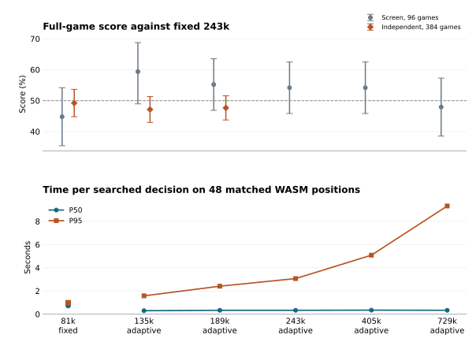

# Battle search saturation, 18–19 November 2026

**The practical adaptive range is a 135k–189k cap at UCB c = 0.40.** Use 135k when typical response time matters. Its 13.5k checkpoints and 0.01 reward-gap threshold cut median search time to 0.30 s on the 48 matched WASM decisions, and it scored 194–190 against adaptive 189k. Fixed 81k gives a more predictable response time. Its median was 0.74 s and its P95 was 0.98 s, versus 1.58 s at P95 for adaptive 135k. On 192 fresh seat pairs the fixed 81k profile scored 189–195 against fixed 243k.

The direct games place 189k on the adaptive strength plateau. Increasing that cap to 405k or 729k raised P95 from 2.41 s to 5.09 s or 9.32 s. The upper 95% limits on their gains were 2.9 and 3.9 percentage points, within the prespecified five-point tolerance. The intervals still allow a five-point advantage for fixed 243k or fixed 729k over adaptive 189k.



The figure shows the ordinary width. Each independent score uses a new set of schedules relative to the screen. The independent 81k and 135k comparisons use the same schedules. The 189k result comes from the preceding holdout.

### Independent matches

Each row used 192 seat-swapped pairs (384 games). The score and interval belong to the first profile. The five-point tolerance was chosen before inspecting results. It corresponds to about 35 Elo near an even matchup. To assess a more expensive profile, compare its one-sided 95% upper score limit with 55%.

| Candidate | Opponent | Wins–losses | Candidate score (95% pair interval) |
| --- | --- | ---: | ---: |
| Adaptive 135k | Adaptive 189k | 194–190 | 50.5% [46.1, 54.9] |
| Adaptive 189k | Fixed 81k | 194–190 | 50.5% [45.8, 55.2] |
| Adaptive 189k | Fixed 243k | 183–201 | 47.7% [43.8, 51.6] |
| Adaptive 189k | Adaptive 405k | 194–190 | 50.5% [46.4, 54.7] |
| Adaptive 189k | Adaptive 729k | 191–193 | 49.7% [45.3, 54.2] |
| Adaptive 189k | Fixed 729k | 184–200 | 47.9% [43.8, 52.1] |
| Adaptive 243k, c = 0.60 | Adaptive 189k, c = 0.40 | 171–213 | 44.5% [40.4, 48.7] |

Increasing the ordinary-width adaptive cap from 189k to 405k or 729k gave opponent score gains of −0.5 and +0.3 percentage points. Their one-sided 95% upper bounds were +2.9 and +3.9 points. Against the same 189k candidate, **fixed** 243k and 729k gained +2.3 and +2.1 points, with upper bounds of +5.7 and +5.5. The data resolve a practical plateau among the higher adaptive caps. A five-point gain from fixed search remains possible.

At the 243k cap, scores against the common reference in the screen changed by −7.3 points for c = 0.25 and −5.2 for c = 0.60 relative to c = 0.40. The paired 95% intervals were [−21.9, +7.3] and [−16.7, +7.3]. The held-out direct loss of the wider 243k profile to ordinary-width 189k measures the combined change in width and cap. Its mean work was 159.5k vs 110.5k iterations per searched decision.

### Cheaper profiles on fresh schedules

Adaptive 135k led the screen with 57 wins in 96 games against fixed 243k. It then split the independent 189k matchup nearly evenly. That prompted a new comparison against both fixed upper anchors and a fixed 81k control, using 192 previously unused schedules. All 4,608 games across the three stages ended with a win or loss before the 500-turn cap.

| Candidate | Opponent | Wins–losses | Candidate score (95% pair interval) | Upper 95% limit on opponent advantage |
| --- | --- | ---: | ---: | ---: |
| Fixed 81k | Fixed 243k | 189–195 | 49.2% [44.8, 53.6] | +4.4 pp |
| Adaptive 135k | Fixed 243k | 181–203 | 47.1% [43.0, 51.3] | +6.5 pp |
| Adaptive 135k | Fixed 729k | 182–202 | 47.4% [42.7, 52.1] | +6.5 pp |

The screen's 59.4% for adaptive 135k against fixed 243k fell to 47.1% on fresh schedules. Against their common fixed 243k opponent, adaptive 135k scored 2.1 points below fixed 81k (95% matched difference −7.6 to +3.4). The historical 512-game ladder gave fixed 243k a 4.5-point advantage over fixed 81k on an earlier revision. On the fresh schedules the one-sided upper bound on a gain from fixed 243k was 4.4 points against fixed 81k and 6.5 points against adaptive 135k.

### Budget, width and early-stopping screen

All eight candidates faced the same fixed 243k agent on the same 48 seat-swapped schedules. Native mean iterations include all battle requests with at least two legal choices. The Node/WASM columns cover a separate set of 48 matched decisions. P50 and P95 are quantiles of individual decision times. All decisions passed the protocol legality checks.

| Candidate | UCB c | Score vs fixed 243k (95% CI) | Mean iterations in full games | WASM P50 / P95 |
| --- | ---: | ---: | ---: | ---: |
| Fixed 81k | 0.40 | 44.8% [35.4, 54.2] | 81.0k | 0.74 / 0.98 s |
| Adaptive 135k | 0.40 | 59.4% [49.0, 68.8] | 92.0k | 0.30 / 1.58 s |
| Adaptive 189k | 0.40 | 55.2% [46.9, 63.5] | 111.6k | 0.33 / 2.41 s |
| Adaptive 243k | 0.25 | 46.9% [37.5, 56.3] | 132.3k | 0.42 / 3.02 s |
| Adaptive 243k | 0.40 | 54.2% [45.8, 62.5] | 140.6k | 0.33 / 3.07 s |
| Adaptive 243k | 0.60 | 49.0% [40.6, 57.3] | 141.2k | 0.54 / 2.61 s |
| Adaptive 405k | 0.40 | 54.2% [45.8, 62.5] | 207.7k | 0.35 / 5.09 s |
| Adaptive 729k | 0.40 | 47.9% [38.5, 57.3] | 349.4k | 0.33 / 9.32 s |
| Fixed 243k timing reference | 0.40 | — | 243.0k | 2.55 / 3.52 s |

The 243k cap isolates the stopping rule at ordinary width and compares the two alternative widths at the same cap and cadence. The wider alternative advanced to the independent comparison after scoring 47/96 against the fixed reference, compared with 45/96 at the narrower width. The ordinary width scored 52/96. The same 17 of 48 WASM decisions reached every ordinary-width cap from 135k through 729k. In a second pass on the same roots, fixed 729k took 10.32 / 15.32 s (P50 / P95), fixed 243k took 3.04 / 4.39 s and adaptive 135k took 0.37 / 1.90 s.

### Spectator decisions

One decision was sampled per spectator game and 567 of 570 were searchable. All rows use ordinary width, a 13.5k check interval and a 0.01 reward gap. The final column counts changes when the *same tree* continued from an early stop to the profile's own cap. It measures action stability.

| Cap | Mean iterations | Median iterations | Early stops | Early choices changed at their own cap |
| ---: | ---: | ---: | ---: | ---: |
| 135k | 94.4k | 135k | 254/567 | 2/254 |
| 189k | 123.8k | 189k | 261/567 | 3/261 |
| 243k | 152.3k | 243k | 271/567 | 5/271 |
| 405k | 235.8k | 405k | 276/567 | 5/276 |
| 729k | 399.1k | 675k | 287/567 | 6/287 |

P95 iterations reached the cap in every spectator profile. Increasing the cap from 243k to 729k added 16 early stops and 246.8k mean iterations. At 189k, 306/567 spectator decisions reached the cap, compared with 17/48 in the WASM sample.

### Protocol and reproduction

The experiment continues the ordinary blind search in `8d0180fe` and the interrupted budget study in `8e2e9f49`. The local experiment branch `experiment/search-saturation-duels` at `e81f7f19` contains the probes and analysis tools. The shipped fixed battle profile is 81k.

We sampled teams by draw weight from `team-pool-v2` and used `belief-pool-v3` for inference. Each seat used its own precomputed 27k preview choice, shared across swaps and matchups for the same schedule. Swapping which agent occupied each seat preserved the teams, battle RNG and two independent seat RNG seeds. Each matchup score is the mean over full games, with a draw or turn cap worth half a point. The two-sided 95% intervals and one-sided 95% limits come from the exact empirical bootstrap distribution over whole seat pairs. Reusing a schedule across matchups pairs their results. Schedules 0–47 screened the candidate profiles and selected the alternative width. Schedules 48–239 tested the 189k candidate. The cheaper-profile follow-up used schedules 240–431. Self-play estimates depend on the team distribution and opponent.

The stop rule checks every 13,500 battle iterations. A public singleton can stop immediately. Otherwise two adjacent checkpoints must select the same visit leader, every eligible rival needs at least one visit and fewer visits than the root LP cutoff, and the smallest reward lead must be at least 0.01. A disagreement with the request's legal action set disables the protocol shortcut. The width parameter is the UCB exploration constant `c`. Fixed arms use `c = 0.4`.

Build `budget_probe` and `adaptive_budget_probe` in release mode in a checkout of the experiment revision. For example, the following reproduces the 189k vs fixed 243k confirmation and its interval. Omitting a side's `--stop-` option selects fixed search. Use `--c-a` or `--c-b` for a width variation.

```sh
cargo build --release -p nc2000-bot --example budget_probe --example adaptive_budget_probe
probe=target/release/examples/budget_probe
"$probe" duel --iters-a 189000 --stop-a 13500,0.01 --iters-b 243000 \
  --pair-start 48 --pairs 192 --seed 20261118072 --preview-iters 27000 \
  --preview-cache preview.json --out duel.jsonl
python3 tools/summarize-budget-duels.py --start 48 --pairs 192 \
  --seed 20261118072 --preview-iters 27000 duel.jsonl
```

For spectator iteration counts, extract the `spectator/*.raw.log` entries of `data/corpus-spectator-logs.zip` and run `adaptive_budget_probe SPECTATOR_DIR 570 2 20261118 trace.jsonl 729000`. The first 18 checkpoints on each of the 567 reconstructed decisions matched every non-timing field in the saved 243k study. Apply the same stop rule to the checkpoint trace.

For Node/WASM timing, collect 120 games with `budget_probe collect-positions --pairs 120 --iters 3000 --preview-iters 27000 --seed 20261118071 --out games.json` and run `budget_probe convergence --games games.json --one-per-game --samples 120 --seed 20261118073 --checkpoints 13500 --out roots.jsonl`. Use Python `random.Random(20261118074).sample(rows, 48)` in trace order and save the resulting `game_idx`, `step_idx`, `side`, and `turn` fields as `slots.json`. In a timing-only checkout of `8e2e9f49`, set `BATTLE_CAP = 729_000`, `INTERVAL = 13_500` and `MIN_GAP = 0.01` in `adaptive_budget.rs` and run `crates/wasm/build.sh nodejs`. From the experiment checkout run `node tools/time-search-profiles.cjs PATH_TO_PKG_NODE/nc2000_wasm.js games.json slots.json times.json`. Each root uses the same observed prefix, own team and decision seed across profiles. Arm order rotates and reverses. Timings cover the search and final choice in a single Node 22 process on Apple Silicon. For the second pass append the profile list `a135,f243,f729` and use a new output file. The duplicate profiles returned identical moves and iteration counts in both passes.
